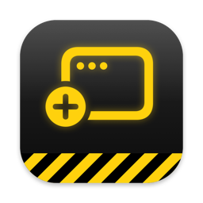

<p align="center">
  
</p>

<h1 align="center">OpenWell</h1>

<p align="center">
  <a href="https://github.com/moetiker/OpenWell/actions/workflows/ci.yml"></a>
  <a href="https://github.com/moetiker/OpenWell/releases/latest"></a>
  <a href="LICENSE"></a>
  
</p>

OpenWell opens terminal windows from the Dock and puts every new terminal window on a
free spot of the screen. A click on the Dock icon opens a new window in the terminal of
your choice, and Cmd+N in the terminal gets the same placement.

I like how window managers on Linux place a new window where it covers nothing. macOS
opens it on top of the previous one. OpenWell brings the Linux way to terminal windows
on the Mac.

It runs on macOS 13 or later, on Apple silicon and Intel Macs.

## Install

    brew tap moetiker/OpenWell https://github.com/moetiker/OpenWell
    brew trust --cask moetiker/openwell/openwell
    brew install --cask openwell

`brew trust` exists from Homebrew 6 on; skip it on older versions.

Or download the zip from the [latest release](https://github.com/moetiker/OpenWell/releases/latest)
and move OpenWell.app into the Applications folder.

On the first start macOS asks for Accessibility access. Click **Open System Settings**
and switch OpenWell on under Privacy & Security > Accessibility. If OpenWell is not
in the list, add /Applications/OpenWell.app with the plus button.

## Use

Keep OpenWell in the Dock.

- `Click`: Open a new window in the chosen terminal. If the terminal is not running,
  OpenWell starts it.
- `Cmd+N` in a terminal: The new window lands on a free spot.
- `Cmd+N` with OpenWell in front: Same as a click on the Dock icon.

The Dock menu (right-click or Control-click on the icon) has these items:

- `New Tab`: Open a tab in the chosen terminal.
- `Terminal`: Choose the terminal a Dock click opens. The submenu lists the terminals
  installed on the Mac.
- `Open at Login`: Start OpenWell at login. Started this way, it opens no window.
- `Edit Config`: Open the configuration file.

OpenWell looks for a free spot on the screen under the mouse pointer after a Dock click,
and on the screen of the focused window after Cmd+N in a terminal. The first choice is a
spot that covers no window; then one that covers no terminal window; then the spot with
the least overlap. Among equal spots, the one closest to the preferred corner wins.

Windows a terminal restores after a restart, and windows of a terminal in the
background, stay where the terminal puts them.

## WezTerm

WezTerm can create the new window directly at the free spot. Add this to
`~/.wezterm.lua`, after `config.keys` is set:

```lua
local OPENWELL = '/Applications/OpenWell.app/Contents/MacOS/OpenWell'
table.insert(config.keys, {
  key = 'n',
  mods = 'CMD',
  action = wezterm.action_callback(function()
    local args = { cwd = wezterm.home_dir }
    local ok, success, stdout = pcall(wezterm.run_child_process, { OPENWELL, '--spot' })
    if ok and success then
      local x, y = stdout:match('(-?%d+),(-?%d+)')
      if x then
        args.position = { x = tonumber(x), y = tonumber(y), origin = 'ScreenCoordinateSystem' }
      end
    end
    wezterm.mux.spawn_window(args)
  end),
})
```

`OpenWell --spot` prints the position `x,y` for the next window of the chosen terminal.
Without OpenWell, the binding opens the window at WezTerm's default position. A Dock
click uses the same binding.

## Configuration

`~/Library/Application Support/OpenWell/config.json` is created on the first start. OpenWell reloads it when
it changes.

```json
{
  "terminal": "com.github.wez.wezterm",
  "manage": ["com.github.wez.wezterm", "com.googlecode.iterm2", "com.apple.Terminal"],
  "gap": 10,
  "anchor": "top-left"
}
```

- `terminal`: Bundle ID of the terminal a Dock click opens. The Dock menu sets it.
- `manage`: Bundle IDs of the apps whose new windows OpenWell places, in addition to the
  terminals it finds on the Mac.
- `gap`: Distance between windows in points.
- `anchor`: Preferred corner, `top-left`, `top-right`, `center` or `mouse`. After a Dock
  click, `mouse` counts as `top-left`.

## Build

Building needs Xcode or the Command Line Tools with Swift 6.

    make app        # build/OpenWell.app
    make install    # into /Applications
    make test

The build signs with the first Developer ID Application certificate in the keychain,
and ad hoc without one. `SIGN_IDENTITY` names another identity, `-` forces ad hoc.

## Troubleshooting

OpenWell logs what it does to the unified log:

    /usr/bin/log show --last 5m --predicate 'subsystem == "ch.oetiker.OpenWell"'

After a rebuild signed ad hoc, macOS no longer recognises the app. `make install` resets
its Accessibility entry, and macOS asks for access again on the next start. If OpenWell
is listed but places no windows, remove it from the Accessibility list with the minus
button and start it again.
